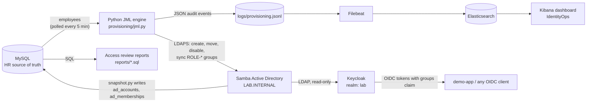

# IdentityOps Lab

A small, self-contained identity platform that runs in a single Ubuntu VM. It shows the full joiner-mover-leaver lifecycle end to end: an HR database drives accounts and role-based access in Active Directory (provided by Samba), Keycloak provides SSO on top of AD, and every action is logged to Elasticsearch and shown on a Kibana dashboard.

It is built entirely with open-source components. It mirrors the kind of identity governance and operations work described in my CV (HR-driven provisioning, RBAC, access reviews, audit evidence and monitoring), without using any proprietary product or employer data. I used Claude, an AI assistant by Anthropic, for planning and code drafting. I built the lab hands-on in a UTM virtual machine, tested the full lifecycle, and troubleshot the problems listed below.

**Lab only.** This stack is a learning environment, not a hardened deployment. Kibana and Keycloak run without production security and are reachable from the local network, and Elasticsearch has authentication turned off.

> **Setup and configuration:** see [docs/SETUP.md](docs/SETUP.md) for the full installation guide, configuration reference, known lab shortcuts and troubleshooting. This page covers what the lab is, what it demonstrates and how to demo it.

## What it does

- **Joiner:** a new row in the HR database creates an AD account with a forced password change and assigns role groups.
- **Mover:** a job title change in HR removes the old role groups and adds the new ones, with no manual steps.
- **Leaver:** a terminated employee is disabled, stripped of all role groups and moved to a Disabled OU, and loses SSO access.
- **Drift correction:** manual group changes in AD that don't match the HR-driven role model are reverted on the next run.
- **SSO:** Keycloak federates AD (read-only) and issues OIDC tokens that carry the user's role groups.
- **Audit and reporting:** every action is written as a JSON event. A Kibana dashboard shows the audit trail and errors, and SQL reports cover leavers with access, orphaned accounts, dormant accounts and manager access reviews.

## Architecture



HR is the only place where people are created, changed or removed. The engine reconciles AD to match HR. Keycloak only reads from AD, so SSO access always follows what the engine has done.

| Component | Runs as | Purpose |
|---|---|---|
| Samba AD DC | native on the VM | Active Directory-compatible domain (LDAP, Kerberos, DNS) |
| MySQL 8.4 | Docker | HR source of truth, plus AD snapshot tables for reporting |
| JML engine (Python, `ldap3`) | cron, every 5 min | Joiner-mover-leaver automation |
| Keycloak 26 | Docker | SSO / OIDC on top of AD |
| Filebeat, Elasticsearch, Kibana 8.15 | Docker | Audit log ingestion, search and dashboard |

## Role model

Roles are defined in `provisioning/roles.yaml`. Everyone gets a baseline role, and job titles map to additional roles. Each role is an AD security group named `ROLE-<name>`.

| Job title | Roles assigned |
|---|---|
| Finance Analyst | Employee-Base, Finance-Analyst |
| Finance Manager | Employee-Base, Finance-Approver |
| IT Support Engineer, IT Manager | Employee-Base, IT-Support |
| HR Partner | Employee-Base, HR-Partner |

The engine is idempotent: running it twice in a row changes nothing the second time. Errors are isolated per employee, so one bad record doesn't stop the rest of the run.

## Repository layout

```
identityops-lab/
├── infra/docker-compose.yml     MySQL, Keycloak, Elasticsearch, Kibana, Filebeat
├── hr-source/schema.sql         HR schema, snapshot tables and seed employees
├── provisioning/
│   ├── jml.py                   joiner-mover-leaver engine
│   ├── snapshot.py              copies AD state into MySQL for reporting
│   └── roles.yaml               role model
├── reports/                     SQL access reviews
├── monitoring/
│   ├── filebeat.yml             log shipping config
│   └── dashboard.ndjson         Kibana dashboard export
├── docs/SETUP.md                installation, configuration and troubleshooting
├── run.sh                       cron entry point (engine, then snapshot)
├── kc_token.sh                  helper to fetch a Keycloak token and show its groups
├── requirements.txt
└── .env.example                 variable names (copy to .env and fill in)
```

## Demo

Prepare the shell once:

```bash
cd ~/identityops-lab && source .venv/bin/activate
set -a; . ./.env; set +a
export MYSQL_PWD="$DB_PASS"
export DEMO_PASS='<a password that meets AD complexity rules>'
source kc_token.sh
hr() { mysql -h127.0.0.1 -ujml hr "$@"; }
```

### 1. Joiner: a new hire appears in HR

```bash
hr -e "INSERT INTO employees (employee_id, first_name, last_name, department, job_title, manager, start_date)
       VALUES (2001,'Viktor','Angelov','Finance','Finance Analyst','Ivan Georgiev',CURDATE());"
python -W ignore provisioning/jml.py
tail -4 logs/provisioning.jsonl                       # user_created, 2x group_added
sudo samba-tool group listmembers ROLE-Finance-Analyst
```

### 2. SSO: the new account works, and the token carries the roles

```bash
sudo samba-tool user setpassword vangelov --newpassword="$DEMO_PASS"
kc_token vangelov                        # groups: ROLE-Employee-Base, ROLE-Finance-Analyst
```

### 3. Mover: a promotion changes the access

```bash
hr -e "UPDATE employees SET job_title='Finance Manager' WHERE employee_id=2001;"
python -W ignore provisioning/jml.py
tail -3 logs/provisioning.jsonl                       # group_added Finance-Approver, group_removed Finance-Analyst
kc_token vangelov                                     # groups now include ROLE-Finance-Approver
```

If the token still shows the old groups, run **Sync all users** on the Keycloak LDAP provider and request a new token.

### 4. Idempotency: running again changes nothing

```bash
before=$(wc -l < logs/provisioning.jsonl)
python -W ignore provisioning/jml.py
tail -n +$((before+1)) logs/provisioning.jsonl        # only run_complete
```

### 5. Leaver: access is removed everywhere

```bash
hr -e "UPDATE employees SET status='terminated', end_date=CURDATE() WHERE employee_id=2001;"
python -W ignore provisioning/jml.py
sudo samba-tool user show vangelov | grep -iE '^dn:|userAccountControl'   # OU=Disabled, 514
kc_token vangelov                        # LOGIN FAILED
```

### 6. Audit trail

```bash
jq -c 'select(.employee_id==2001)' logs/provisioning.jsonl
```

In Kibana, refresh the **IdentityOps** dashboard (time range: last 15 minutes). The audit trail panel lists the same events.

### 7. Access review reports

```bash
python -W ignore provisioning/snapshot.py
mysql -h127.0.0.1 -ujml hr -t < reports/04_manager_access_review.sql   # who has which role, by manager
mysql -h127.0.0.1 -ujml hr -t < reports/01_leavers_with_access.sql     # empty: no leaver keeps access
mysql -h127.0.0.1 -ujml hr -t < reports/02_orphaned_accounts.sql       # AD accounts that are not in HR
```

### 8. Drift correction: a manual change is reverted

```bash
sudo samba-tool group addmembers ROLE-Finance-Approver apetrova      # out-of-band change
sudo samba-tool group listmembers ROLE-Finance-Approver
python -W ignore provisioning/jml.py
tail -1 logs/provisioning.jsonl                       # group_removed ROLE-Finance-Approver
sudo samba-tool group listmembers ROLE-Finance-Approver
```

### Reset the demo data

```bash
hr -e "DELETE FROM employees WHERE employee_id=2001;"
sudo samba-tool user delete vangelov
```

## Issues encountered and how I fixed them

Problems I ran into while building and testing the lab, and what fixed them.

- **Elasticsearch rejected the audit events.** Its default field mappings treat `event` as an object, while the engine logs it as a plain string, so every event was dropped with a 400 error and the index stayed empty. I fixed it by turning off Filebeat's template management, deleting the old data streams and template, and recreating the Filebeat container so it re-read the log file from the start.
- **A cron run right after boot failed.** It started before MySQL was accepting connections, and the old error stayed in the append-only `cron.log`, which made it look current. `run.sh` now waits up to 60 seconds for the database and writes timestamps to the log.
- **Keycloak users couldn't sign in.** I was using the master realm login instead of `/realms/lab/account`, and Keycloak's default user profile required an email address that the engine doesn't set ("Account is not fully set up"). I used the correct realm URL and relaxed the email requirement. New AD accounts also have a forced password change, so a password has to be reset before a token test.
- **MySQL refused connections on its first start.** The first start initialises the database, which takes 30 to 60 seconds, so connecting too early gave "Lost connection". Waiting for the ready message fixed it.
- **A container image failed to download.** The Keycloak image pull returned a `502 Bad Gateway` from the registry. Retrying and pulling images one at a time resolved it.
- **The audit trail couldn't be a Lens table.** Lens tables only show aggregated data, so I built the audit trail as a saved Discover search and added it to the dashboard. My first dashboard export contained only two panels because the search wasn't saved into the dashboard, which I caught by checking `exportedCount` in the export.
- **Elasticsearch didn't answer on the VM's IP address.** It is deliberately bound to `127.0.0.1`, so it is only reachable from inside the VM. Kibana reaches it over the Docker network.
- **A terminated user disappeared from Keycloak.** This is expected: Keycloak only searches the Users OU, so an account moved to the Disabled OU drops out of the user list and can no longer sign in.
- **Some generated commands needed correcting.** For example, one password reset command used an option that `samba-tool` doesn't accept. I tested each step on the VM and corrected the documentation.
